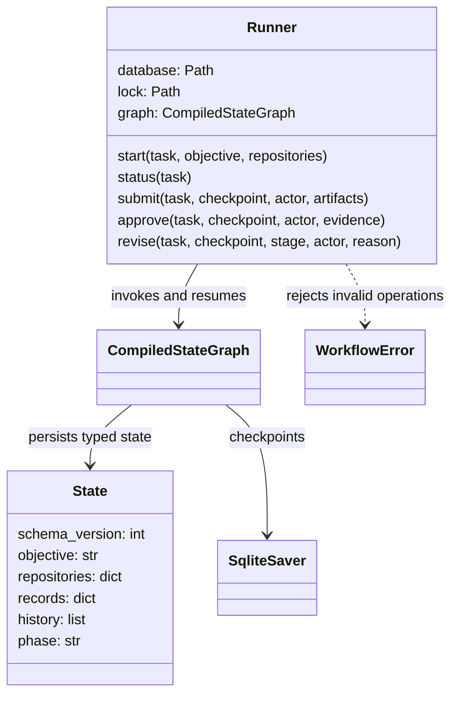
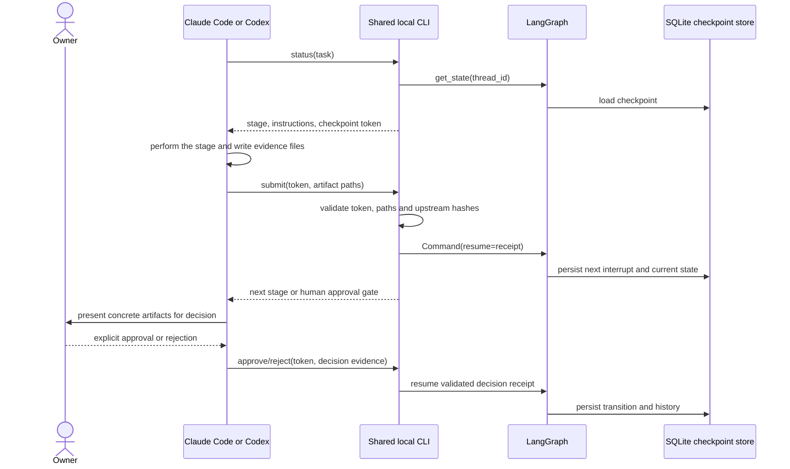

# Current local engineering runner architecture

Source: `tools/engineering_flow/workflow.py`, `flow.py` and `tools/engineering.ps1`. These diagrams describe the local implementation, not the marketplace or a proposed distributed agent platform.

## Component responsibilities

`records` contains current stage receipts, while `history` retains accepted receipts and revision/rejection events. Artifact references contain a registered repository alias, relative path and SHA256, not file contents. SQLite stores LangGraph checkpoints; there is no new Django model or application migration.

## Work and approval sequence

The local CLI does not independently authenticate the owner or verify reported test success. Host instructions govern whether the assistant may record approval or execute actions. An external multi-user service would require additional identity, authorization, isolation and persistence design.

## Failure/revision behavior

- Stale checkpoint: reject the request; read current status.
- Changed upstream artifact: refuse advancement; revise the earliest affected stage.
- Design rejection: return to architecture; discard current downstream records/approvals.
- Implementation-plan rejection: return to planning.
- Failed spec or quality review: return to implementation; both review perspectives run again.
- Concurrent process: fail on the exclusive local lock; do not mutate the graph.
- Process restart: reopen the same task in the shared SQLite store.
- Crash leaving a lock file: operator verifies no process remains before removing only the lock file. No automatic lock stealing.
