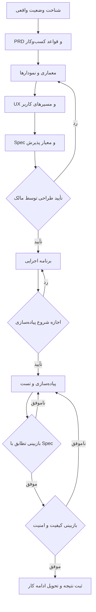

# گردش کار BMAD + LangGraph در Claude Code و Codex

## تصمیم اجرا

انتخاب مالک در ۲۷ اکتبر ۲۰۲۶: «مدیریت مراحل و تأییدها با LangGraph؛ اجرا در Claude/Codex فعلی». این ابزار محلی است؛ مدل را از API فراخوانی نمی‌کند، دستورات shell اجرا نمی‌کند و خودکار ایجنت ایجاد نمی‌کند. LangGraph کار بعدی را مشخص می‌کند؛ همان دستیار فعلی کار را انجام می‌دهد و گزارش و مسیر فایل‌های واقعی را ثبت می‌کند.

- **BMAD:** تحلیل، PRD، معماری، UX و مشخصات؛
- **LangGraph:** ترتیب مراحل، توقف، ثبت وضعیت و ادامه از checkpoint؛
- **Claude/Codex:** اجرای مرحله با اسکیل مرتبط؛
- **Superpowers:** برنامه اجرایی، TDD و بازبینی در مراحل مربوط؛
- **OpenSpec:** مرجع نیازمندی محصول موجود؛ اسناد BMAD به تغییر مربوط لینک می‌دهند.

## مراحل



معماری در صورت نیاز شامل Flowchart، ERD، Class و Sequence Diagram است. نمودارهای وضعیت موجود باید از روی کد تأیید شوند. برای یک مرحله نامرتبط، گزارش کوتاهی با دلیل عدم کاربرد ثبت کنید؛ خروجی انجام‌نشده را انجام‌شده اعلام نکنید.

## نصب و محل وضعیت

کد اصلی در بک‌اند، `tools/engineering_flow` است؛ محیط مجازی و وابستگی‌های آن از محیط Django جدا هستند. نسخه‌ها و هش وابستگی‌ها در `uv.lock` ثبت شده‌اند. برای نصب در یک checkout جدید:

```powershell
uv sync --frozen --project tools/engineering_flow
```

در هر دو مخزن، `tools/engineering.ps1` همان runner بک‌اند را اجرا می‌کند. در اجرای معمول از محیط نصب‌شده و حالت آفلاین استفاده می‌شود. Python موردنیاز حداقل ۳٫۱۱ است. نیازی به کلید API مدل یا LangSmith نیست؛ tracing این ابزار غیرفعال است.

وضعیت همه کارها به‌صورت محلی در بک‌اند ذخیره می‌شود:

```text
.engineering-state/workflow.sqlite3
```

این مسیر در Git نیست. Claude و Codex روی همین دستگاه با همان شناسه کار و دیتابیس ادامه می‌دهند. برای جابه‌جایی بین دستگاه‌ها، پس از پایان اجرای همه runnerها از وضعیت محلی نسخه پشتیبان بگیرید؛ صرف git pull وضعیت اجرا را منتقل نمی‌کند. این نسخه یک runner محلی تک‌نویسنده است، نه سرویس چندکاربره یا ابزار اجرای توزیع‌شده.

## شروع یک کار

از ریشه بک‌اند؛ شناسه و هدف را متناسب با کار واقعی انتخاب کنید:

```powershell
powershell.exe -NoProfile -ExecutionPolicy Bypass -File tools/engineering.ps1 start sales-design --objective "تحلیل ماژول فروش" --repo "backend=." --repo "frontend=../../kavehmetal front"
```

از ریشه فرانت‌اند نیز همین launcher کار می‌کند؛ مسیر ثبت مخزن‌ها را نسبت به همان پوشه وارد کنید. برای خواندن وضعیت در هرکدام:

```powershell
powershell.exe -NoProfile -ExecutionPolicy Bypass -File tools/engineering.ps1 status sales-design
```

پاسخ JSON شامل `stage`، راهنمای اسکیل، `checkpoint`، گزارش‌ها و قدم بعد است. `start` دوباره برای همان شناسه پذیرفته نمی‌شود؛ ادامه کار با وضعیت موجود انجام می‌شود.

## ثبت خروجی مرحله

Claude یا Codex فایل مرحله را می‌سازد، نتیجه بررسی را در آن می‌نویسد و با checkpoint فعلی ثبت می‌کند. مقدار `TOKEN` را از آخرین پاسخ `status` بردارید:

```powershell
powershell.exe -NoProfile -ExecutionPolicy Bypass -File tools/engineering.ps1 submit sales-design --checkpoint TOKEN --by codex --artifact backend:docs/engineering/reports/sales-context.md
```

برای چند خروجی، `--artifact` را تکرار کنید. مسیرها باید داخل مخزن ثبت‌شده باشند. برای `spec_review` یا `quality_review`، گزارش بازبینی الزامی است و `--outcome fail` کار را به پیاده‌سازی برمی‌گرداند. این رسید، گزارش مجری است؛ ابزار خودش صحت تست یا استقلال بازبین را اثبات نمی‌کند. دستیار باید فرمان‌ها، نتیجه واقعی و محدودیت بازبینی را دقیق ثبت کند.

## تأیید انسان

در `design_approval` و `implementation_approval`، فرمان submit پذیرفته نمی‌شود. ابتدا فایل‌ها به مالک ارائه می‌شوند؛ پس از تأیید صریح، متن یا مرجع همان تصمیم ثبت می‌شود:

```powershell
powershell.exe -NoProfile -ExecutionPolicy Bypass -File tools/engineering.ps1 approve sales-design --checkpoint TOKEN --by Aria --evidence "متن یا مرجع تأیید واقعی مالک"
```

برای رد، به‌جای `approve` از `reject` استفاده کنید و دلیل مالک را بنویسید. دستیار حق ساختن تأیید، جا زدن خودش به‌جای مالک یا استفاده از این نصب به‌عنوان مجوز همه تغییرهای آینده را ندارد. اگر تأیید همان خروجی قبلاً در گفتگو داده شده، همان تصمیم معتبر ثبت می‌شود و تأیید تکراری درخواست نمی‌شود.

این CLI روی دستگاه مالک اجرا می‌شود و احراز هویت چندکاربره ندارد؛ نام `--by` و متن evidence را مجری محلی وارد می‌کند. ثبت نام مالک به‌تنهایی اثبات رمزنگاری‌شده هویت او نیست.

## تغییر طرح یا بازیابی

هش SHA256 خروجی‌ها ثبت می‌شود. خروجی تغییرکرده بدون بازگشایی مرحله تأیید نمی‌شود. برای بازگشت، از مرحله مربوط استفاده کنید؛ خروجی‌ها و تأییدهای بعدی از وضعیت جاری حذف، اما تاریخچه آن‌ها حفظ می‌شود:

```powershell
powershell.exe -NoProfile -ExecutionPolicy Bypass -File tools/engineering.ps1 revise sales-design --checkpoint TOKEN --by codex --stage architecture --reason "قواعد طراحی تغییر کرده‌اند"
```

checkpoint قدیمی رد می‌شود؛ وضعیت تازه را بخوانید. پس از پایان کامل یک کار، تغییر جدید را با شناسه تازه و لینک به قبلی شروع کنید. در صورت crash و باقی‌ماندن فایل `.lock`، ابتدا مطمئن شوید runner دیگری فعال نیست؛ سپس فقط همان فایل قفل را حذف کنید. دیتابیس را برای عبور از خطا حذف یا بازنویسی نکنید.

## مرزها

- تکمیل گراف یعنی گزارش مراحل ثبت شده است؛ به معنی انتشار سایت، ارسال پیامک یا مجوز deploy نیست.
- این runner فعلاً کار و تأیید را از CLI می‌گیرد؛ برای آغاز اجرا باید دستیار دستور status/start را بزند. نصب، خودش یک حلقه پس‌زمینه دائمی ایجاد نمی‌کند.
- فایل‌های کلید خصوصی، `.env`، دیتابیس و محیط مجازی به‌عنوان artifact رد می‌شوند. فایل خروجی مجاز هم نباید حاوی اسرار باشد.
- هر دو ابزار باید از همین دیتابیس استفاده کنند؛ دو نفر هم‌زمان روی یک وضعیت ننویسند. فایل‌های محلی وضعیت را از منبع نامطمئن باز نکنید.

منابع فنی: [Interrupts در LangGraph](https://docs.langchain.com/oss/python/langgraph/interrupts)، [Persistence](https://docs.langchain.com/oss/python/langgraph/persistence).
