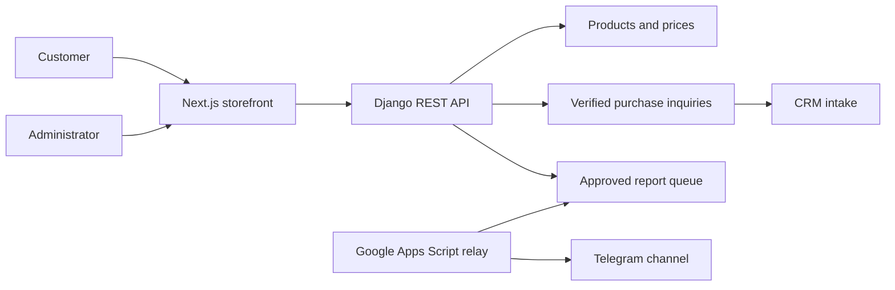

# Verified repository context

KavehMetal is an existing steel marketplace with admin-managed products, prices, domestic/global markets, messaging and CRM intake. This installation adds development tooling; it does not implement or redesign a complete ERP.

- Backend companion: kavehmetal back/tg1; Django/DRF. Start with tg1/settings.py, tg1/urls.py, products/models.py, assistant/models.py, messaging/models.py and openspec/project.md. Verify behavior in services and tests.
- Frontend companion: kavehmetal front; Next.js App Router, React and Tailwind. Start with package.json, app/components/AppShell.js, relevant routes and app/lib/ API helpers.
- UI is Persian/RTL; preserve brand, typography, focus visibility and responsive behavior.
- Backend checks: .venv/Scripts/python.exe manage.py test <labels> --settings=tg1.settings_test; Django check and migration consistency for model changes. Frontend: node --test <tests>, npx.cmd eslint <changed files>, npm.cmd run build on Windows. Confirm package scripts first. Report unrelated baseline lint failures honestly.
- SMS, Telegram relay, market refresh and purchase inquiry have existing implementations/tests. Do not assume local code is deployed or provider credentials work; mock sends in development.
- Separate Git roots: record changes to contracts in both when needed. Preserve unrelated changes and .env secrets.
- For whole-system ERP modeling, inventory actual modules first and mark missing processes PROPOSED. This entrypoint is not a complete system audit.

Overview only. Detailed diagrams must be derived from the affected feature and code.
