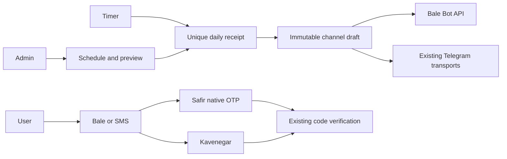
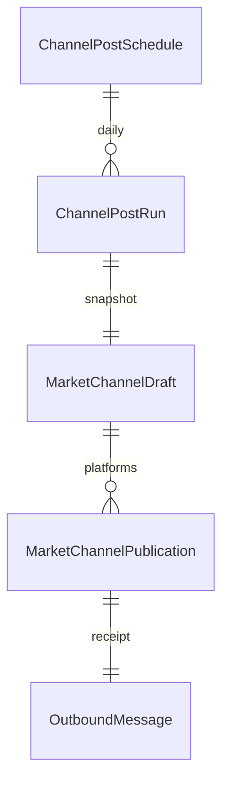

# Bale automation design / PRD / UX — 2026-10-31
Owner explicitly requests daily text/morning channel posts and OTP; reply selects customer choice Bale/SMS. Standing delegation covers routine implementation, not live sends/deploy. OpenSpec add-bale-channel-automation.

CURRENT code: messaging Safir text adapter, market draft/publication/direct and Google relay; accounts hashed5-minute/5-attempt challenge and shared-phone quotas; guest inquiry UUID/hashed payload; authenticated inquiry skips OTP. Reuse these verified services. No implied Telegram phone OTP without verified customer binding.

PROPOSED: MessagingSettings.bale_otp_enabled and channel_posts_enabled defaultfalse. Login challenge captures delivery_channel; disabling selected method invalidates pending verification. Public methods endpoint reveals only available codes/labels. Optional channel defaults SMS for compatibility. Safir native message_data.otp_message preserves leading zeroes. SMS templates retained. Guest payload snapshots method. No automatic fallback; explicit method change shares phone cooldown/quota and changes inquiry UUID as needed. Logs redact OTP/rawresponses. Identity matching/security unchanged.

ChannelPostSchedule title/body<=3500, timeTehran, weekdays0Monday..6Sunday, platforms Bale/Telegram, enabledfalse. Disabled morning seed08:00 all7days. Whitelisted {{jalali_date}}, {{weekday}}, {{site_name}} with rendered<=4000. Run unique(schedule,local_date), immutable MarketChannelDraft snapshot. Reserve under settings/schedule lock before network; only creator dispatches. Same day edits cannot resend. Processing stop becomes unknown after10minutes; never auto retry. Window30minutes, no historical replay. Already-started send cannot be recalled by disabling. Existing publish_draft supports direct/MTProto/Google. Admin messaging section auth; no arbitrary recipient in public API, credentials write-only. Preview does not send; no manual-send endpoint needed. History last30.

UX messaging tab «انتشار روزانه کانال»: global toggle, title/body/time/day/platform form, morning seed, preview/save and readable history. Login/binding/guest choices expose configured methods with precise delivery wording; existing signed-in noOTP unchanged. Mobile keyboard/loading/error/empty supported. No personal drafts in browser storage.

Acceptance: native OTP request zeroes and redaction; Bale-only credentials, disabled/unknown method, commoncooldown, wrong/expired/replayedcode, guest immutable retry, no signed-in OTP; schedule permission/length/weekdays, preview no send, current Jalali, same-daydedupeafteredit, disable/missedday/unknownnoresend, Googlequeuedjob; mocked mobile/desktop UI and existing regressions. Local SQLite does not prove production concurrency. Coordinator writing-plans→executing-plans inlineTDD and one final fresh reviewer.
