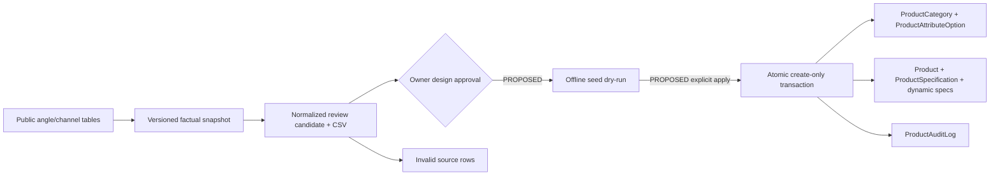
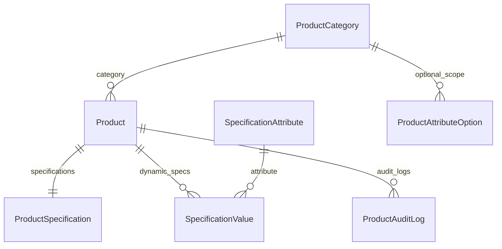

# جریان داده

CURRENT: مدل‌ها و renderer موجودند؛ collector و بستهٔ بررسی این مرحله آماده شده‌اند.
PROPOSED: قسمت apply/import و اتصال به به‌روزرسانی پس از تأیید، هنوز ساخته نشده است.

ERD یک زیرمجموعهٔ تأییدشده از مدل‌های فعلی است؛ seed رابطهٔ جدیدی اضافه نمی‌کند.
