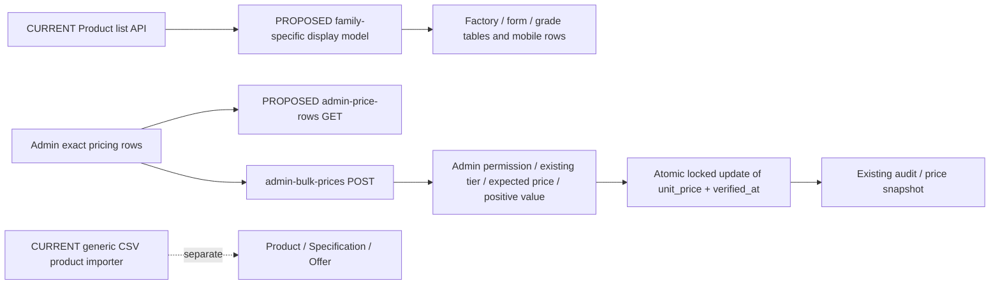
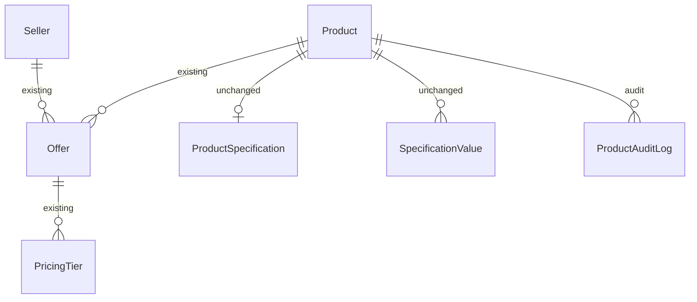

# معماری: وضعیت موجود و مقصد

قفل tierها به ترتیب id؛ اعتبارسنجی مجدد expected_price داخل transaction. هیچ
Product/Offer/Spec/Delivery save یا create/delete در service فقط قیمت مجاز نیست.
اگر خطا باشد batch کامل rollback می‌شود؛ history/audit جزو همان transaction است.
GET قیمت‌ها admin-only و paginated؛ دادهٔ عمومی یا قیمت حداقل، شناسهٔ نوشتن نیست.
