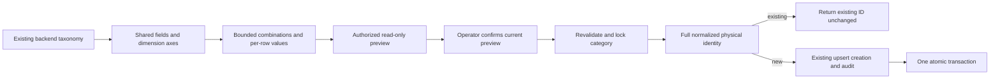

# PROPOSED — matrix architecture

No new domain entity/table. Existing relations: Product → one ProductSpecification; Product → Offers → PricingTiers/DeliveryLocations; Product → ProductAuditLog. Shared spec validation uses an unsaved product/spec so preview writes nothing. Matrix identity includes category and all normalized SPEC_FIELDS, including length_type; legacy blank/null strings are equivalent. Case-insensitive strings and normalized decimals avoid format-only duplicates. Matrix commits lock the existing category row to serialize same-category matrix submissions on PostgreSQL; SQLite remains serialized by its writer lock. This is matrix-route concurrency protection, not a new global identity constraint for every catalog writer.

Contract: POST `/api/products/admin-matrix-preview/` and `/admin-matrix-create/`, JSON `{common:{category_code,seller_id,manufacturing_process,surface_finish,steel_grade,factory,cut_type,price_basis,province,city,address},rows:[{key,thickness_mm,width_mm,length_mm,length_type,price,availability_status}]}`. Unknown identity/control fields rejected. Preview returns `{valid,rows:[{key,name,status:new|exists|error,product_id?,errors?}],new_count,existing_count}`. Commit revalidates; errors 400 without writes, success includes created_count and row IDs/statuses. No price or stock edits for existing IDs. Unexpected write exceptions roll back and return a generic error rather than sensitive internal data.
