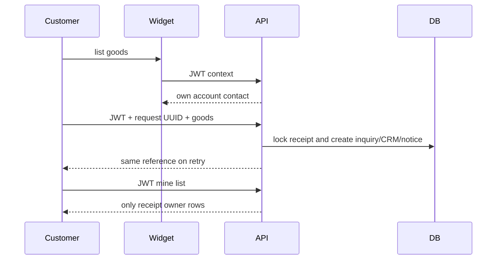

# Easy account workspace and signed-in inquiries ? 2026-10-29
OpenSpec simplify-account-inquiries; LangGraph easy-account-20261029.
## Context/PRD
Current public inquiry forces SMS for everyone; API intentionally anonymous, widget never passes auth. Account shell has long scrolling navigation, dummy search, dense buyer dashboard and account root technical profile. Editable Profile.phone is unverified; PhoneLoginIdentity exists. Need authenticated account-based inquiry without SMS, and a usable low-literacy RTL workspace. Not changing SMS login or guest OTP policy.
## Rules and API
New JWT-only authenticated context GET /api/assistant/purchase-inquiry/account-context/ returns own user_id/name/phone/can_submit. Own valid Profile.phone is contact data (not proof of phone ownership); fallback verified PhoneLoginIdentity if missing/invalid. Name from first/last name, safe username fallback excluding generated mobile name. Missing phone -> explicit account/edit link, no silent guest/SMS fallback. City is optional delivery data entered once per request. Posted phone/name/user cannot choose ownership or override server identity.
POST /api/assistant/purchase-inquiry/account-submit/ {request_id UUID,items[1..50],city?,source_path?}. Validate items/categories same public flow. Atomic AccountPurchaseSubmission UUID owner/payload_hash/one-to-one inquiry receipt; repeated same owner/body returns same reference. Cross-owner or changed-body UUID conflict409 no disclosure. Snapshot quantities/units/details; user/server-contact not taken from request. Existing owner receipt succeeds before revalidating category activity. CRM+notice+receipt atomic, rollback retry safe. No SMS functions/provider calls; notification Bale notice remains independent. Note explicitly account-authenticated; do not claim SMS-verified contact.
GET /api/assistant/purchase-inquiry/mine/?page=1: paginated20, explicit owner via receipt, no historical phone matching/no other-user/private notes/CRM data. Client status labels and items/reference/date only.
## UX architecture
Account/dashboard and account root both simple home: one primary orange request CTA plus readable order/payment entry points, due payment if actual, recent own requests and orders. Secondary tools under More. Desktop white narrow sidebar; mobile bottom4 plus accessible More dialog; no horizontal menus or decorative stats. Existing operational roles only relevant role links, marketplace flag respected, admin link role-gated. Remove nonworking search. Four icon+word choices; 48px targets, clear focus, plain Persian copy, no low-literacy labeling in UI.
New account/inquiries page: new request button and own request list, expandable item details, paginated/retry/empty states. Widget supports inline trigger; logged flow list -> review own contact + optional city -> submit success, no OTP. Guest unchanged. Auth loading cannot trigger guest send; expired auth never falls back to SMS. Remount by account id resets draft/reference on switch/logout. Existing auth context, no persistent personal draft storage.
Profile to account/profile; account/edit Persian minimal name/phone, optional tax/country/language collapsed; existing bind option kept. Backend flat first_name/last_name update only own user, no role escalation. Operational routes/payments/KYC/notifications preserved.
Design palette white/slate50 ground, slate900 text, orange700 main CTA, blue600 current nav; existing Persian font; no new dependency/motion. Wider spacing, max72ch, row hierarchy. Error sections independent; main actions remain usable during a failed data fetch.
## Acceptance
Anonymous/invalid JWT deny account endpoints; active authenticated (including password/Google/no verified mobile) no SMS and server contact. Missing/invalid contact block submit with edit link. Profile edit cannot alter another user/roles. Replays/changed/foreign UUID/CRM failures tests; notices1, CRM1, own history isolation and pagination; guest regressions. Browser authenticated path no code/verify API requests, guest remainsOTP, auth401 has login action not silent SMS, empty/error/phone missing, simple home and all primary/More links, role filtering, mobile/dialog keyboard/focus/no overflow. Production build/lint and fresh final reviewer. No real SMS/Bale/deploy.
## Proposed sequence

