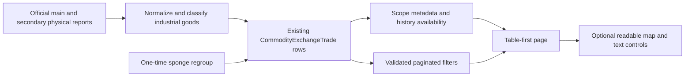

# Industrial commodity exchange design — 2026-11-01
User explicitly authorizes improving this page: table first, clearer filters, readable map, sponge/industrial coverage. Standing delegation covers routine design+implementation; no live deployment or provider writes. Bale templates approved is context only, no template IDs or new integration inferred. OpenSpec improve-industrial-exchange-usability. Prior steel-chain specs remain except scope expansion explicitly authorized here.

CURRENT verified: products.external_markets.STEEL_GROUPS filters importer to6steel groups, sponge nested inore; GoodsName/Symbol/PacketName/Talar lowercase-only matching. Two official main/secondary report calls,14day refresh,31day maxwindow, idempotentrawsource rows. Public API on2026-11-01 latest102rows, sponge search60 historical rows (examples BSC-DRI-00 and KHSS-DRIBRI-00), so missing discovery rather than all data missing. Official IME site not reachable from development network; no statement that full official-day rows independently audited. Summary is latestday, groupmap beforetable, group controls onlymap, 12pxrows, no explicitproducer/tradestatus. Search no Arabic normalization. Exactmap filters/history present.

PROPOSED: new products/commodity_categories.py normalizes Persian/Arabic letters/digits/ZWNJ and word boundaries; named industrial groups priority nonferrous beforegeneric sheet/billet, sponge+DRI/HBI beforeore andsteel. Keep compatibility classify_steel_product wrapper but industrialscope documented. Explicit nonindustrial halls/products rejected; unknown goods accepted only with explicitindustrial/mineral hall/category, grouped «سایر صنعتی و معدنی». No assertion all commodities exist; official datewindow/source limitations visible. Metadata accepted/excluded/raw/group counts aid later diagnostics. One-time migration0025 separates historical sponge names/DRI/HBI without changingraw/units. Other new categories arrive on next existing sync; do not auto-trigger network or purge history at deploy.

Summary date=all explicitly means stored history aggregate; defaultlatest unchanged. available_groups includes stable industrial catalog plus stored groups, global latest date/Jalali and selected-scope records. producers for selectedscope. Table date params validatedISO; trade_status all/traded(volume>0)/untraded(volume<=0ormissing), unknown rejected400. Search normalizes Persian/Arabic in goods/symbol/producer, respects term intersection, raw search kept; page limits<=100. No unit conversion or invented zero. UI no mixed-unit totalcards: show records/symbols/groups only; rowvalues keep originalcurrency/unit.

UX: compact navyheader/sharednav; table primary in firstcontent area. Labelled date/group/producer/search/tradestatus, clear active chips, 48pxtargets, clear all resetslatest/search/scope/status/sort/page/expanded. Separate summary/table errors so successfultable cannot erase summaryfailure. Abort guarded commits, pending filters never show oldrows as matching. Fullwidthsmall-screen controls; horizontalscroll confinedtable;14pxbody, stickyRTLfirstcolumn where feasible. Emptygroup includes laststoreddate action; allhistorical choice explicit. Map aftertable collapsed, 16pxwhiteon darkblue/green/purple labels, keyboard nodebuttons andexactscope breadcrumbs. Data/about compactbelow. Screenshot mobile390+desktop1440.

No new domain entities; class/ERD not needed beyond existingTrade/SyncState. Independent query/controller errors and date-scope transitions must be tested. One inline coordinator writing-plans→executing-plans +TDD, onefresh finalreview. Reuse authorizeddevcheckouts andscopedcommits; no broad reformat. No provider sends, production mutating calls, migration on live DB or deployment. Existing marketreport/Bale flow preserved.

Acceptance: rawindustrial variants incl sponge/aluminum/copper/cement andknownnonindustrial deny, officialidempotency androllbackretained; migration leaves values/raw unchanged; summaryall/default/emptygroupavailability, exactproducer/symbol, badISO/status400, mixedArabicqueryworks; browsertablebeforemap/defaultcollapsed/filters+reset/lastdayrecovery/races/errors/mapkeyboard/mobileoverflow+rowhistory intact. Production backfill requires nextsuccessfulofficialsync, source unavailability must remainhonest.
