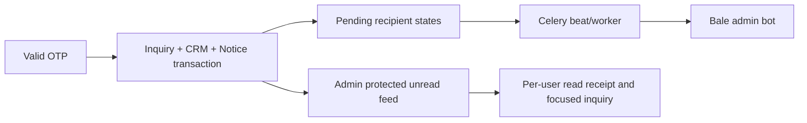

# Verified purchase inquiry alerts

Owner explicitly requests Bale message and on-site admin notification after customer registers an inquiry. Existing verified intake creates inquiry/CRM but does not call chat event alerts; existing admin bell only counts KYC/orders. Scope only phone-verified purchase intake, legacy and multi-item, not drafts/incorrect OTP/chat.

Create one persistent PurchaseInquiryNotice per new verified inquiry inside its transaction, plus per-user read receipts (unique notice/user). Feed/read API requires same assistant admin section as inquiries, no public/customer exposure. Return unread_count and latest20 unread notices with reference, item count, date and aggregate Bale state, no token/phone/chat IDs. Mark-read is per user and does not change inquiry workflow status. Rollback/duplicate verify creates no extra notice.

Bale uses existing admin Bot API settings: telegram_enabled/token/admin_chat_ids but only exact HTTPS https://tapi.bale.ai base (trailing slash allowed). Dedicated notify_on_purchase_inquiry switch defaults true; site notices remain enabled independently. Snapshot recipient IDs and initial pending state at registration; absent/disabled/wrong-host configuration records unconfigured/disabled without external send. Never send to public market channel or SMS. No retroactive historical sends/backfill.

Celery beat every60 seconds dispatches pending notices, so verification makes no network call. Per-recipient state is stored in notice JSON under row lock; commit sending marker before provider request and never automatically resend sending/unknown outcomes. Stale sending after10min becomes unknown; explicit provider success records message ID/sent, rejection/unconfirmed result unknown. Other recipients proceed independently; repeated/concurrent tasks cannot claim same pending recipient twice. Missing config at dispatch skips, changed destinations skip, no secret/provider raw error persisted. Durable feed exists even if worker/broker/provider is unavailable. OutboundMessage logs use admin_alert purpose and generic errors; no automatic uncertain retries.

Bale text: reference, contact name/mobile/city, count, bounded first5 item summaries and HTTPS admin link. All50 items accessible in protected admin. No OTP included. Backend builds link from saved site_base_url. Admin bell polls30 seconds while visible and on focus, retains last data on errors, toasts only newly observed notice IDs after baseline. Count joins existing KYC/order total. Clicking a notice marks only it read and opens assistant inquiries focused/highlighted on its inquiry; direct Bale link opens same tab/row. Error states visible, no browser push permissions requested.

Acceptance: new/legacy verified create one notice, invalid/rollback none; read permissions/independent users; pending/success/unconfigured/unknown/stale states; duplicate/concurrent claims no auto resend; full item count/bounded safe Bale text; browser badge/new toast/read focus/mobile, legacy notification counts preserved. Tests mock providers; no actual messages/deploy authorized by development. Both release packages and migrations required; owner configures private admin Bale destination and running beat/worker.
