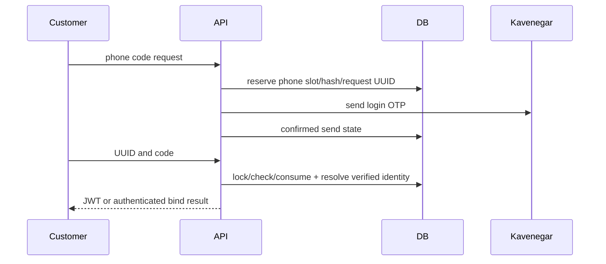

# Mobile SMS login ? context, PRD, architecture, UX and acceptance
2026-10-28. OpenSpec add-mobile-sms-login.

CURRENT: username/password JWT and Google login exist. Profile.phone is freely editable/unverified/nonunique, so cannot grant login. Kavenegar and redacted purchase OTP flow exist. Login SMS has no implementation.
GOAL: optional mobile SMS login/signup, admin switch, separate login template, password remains available. Bale OTP is outside this change.

RULES: SiteSettings.sms_login_enabled default false (installation must not incur messages). Public settings expose only boolean. Admin Settings controls switch. Messaging settings login_otp_template separate from inquiry template; empty uses explicit login text. Configured Kavenegar required. No actual provider calls in development.
AUTH: PhoneLoginIdentity unique normalized phone and one per user, created only after OTP. Never migrate/link editable Profile.phone automatically. Existing unverified-profile phone prevents auto-signup after OTP: user signs in with password and binds number from account/edit. Authenticated binding is own user only; no silent replacement of bound phone/another user. New unclaimed phone auto-creates active buyer with unusable password, random username, no seller/admin grants. Inactive identity cannot login. Turn-off blocks issue/verify/bind, including pending challenges; password/Google unchanged.
OTP: six numeric digits, hashed only, five-minute TTL, five wrong attempts, consumed once under row lock. One challenge slot per canonical phone; new send invalidates old ID. Claim state before network; result marks sent only for current request. No automatic retry of provider uncertainty.60sec perphone cooldown;3/hour and10/day perphone; IP issue10/hour,verify30/min; separate global200/day configurable SMS_LOGIN_DAILY_LIMIT plus shared messaging cap. Authentication cache fail-closed. Independent namespace prevents purchase-code reuse. Provider logs redact body/error/raw code. No tokens for code issue, malformed/expired/wrong/used codes.
UX: compact SMS/password choice in existing blue/RTL login card; tel/autocomplete and six-digit one-time-code with accessible labels. Mobile form handles busy/error/cooldown/resend/edit number, success same auth context and admin destination. Account/edit offers OTP binding when enabled; no tokens issued by binding. Settings switch labeled and hint to messaging separate login template.
API: POST /api/auth/mobile/code/ {phone}; POST /api/auth/mobile/verify/ {request_id,code} -> existingJWT shape. POST authenticated /api/auth/mobile/bind/code/ and /bind/verify/ same inputs; bind -> {ok:true,phone}. GET /api/auth/mobile/binding/ own identity.400 invalid;409 linking conflict after OTP;403 disabled/inactive;429 rate;503 config/cache/provider.
TESTS: defaultoff/APIadminpermission; Persian/+98 normalization; hashes/logredaction; successful new and repeat identity login; replay/expiry/attempt5/old resend; offpending; invalidphone; config/provider/cache failure; rates/cap; inactive; existingunverified/duplicate phones not linked; bound user matchingauth; identity conflict; template independent. Frontend helper units and mocked browser enabled/disabled/login/wrongcode/resend/bind/settings persistence; build/lint/screenshots.

PROPOSED:

No deployment or live message authorization inferred. Existing frontend unrelated docs preserved.
