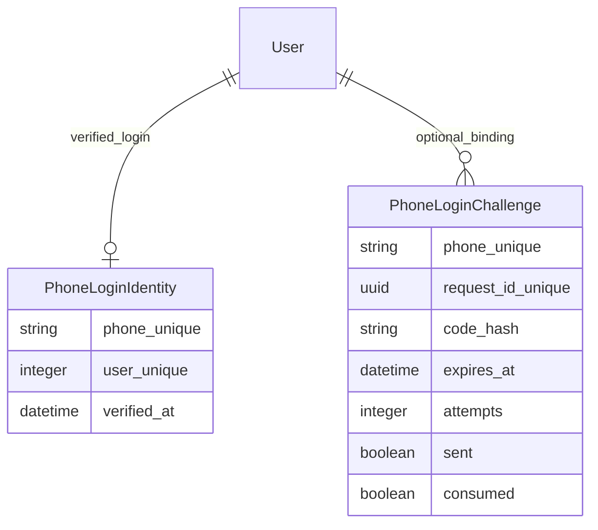

# Mobile login verification — 2026-10-28

OpenSpec add-mobile-sms-login; LangGraph mobile-sms-login-20261028.
Base backend fb5b60b, frontend f6db6ca. Feature commits be30790/cf663f3.

## Spec-compliance checks
Public mobile/code and mobile/verify enforce SiteSettings.sms_login_enabled, default false. Own-account bind/code, bind/verify require JWT and same bind_user snapshot. PhoneLoginIdentity has unique canonical phone and one-to-one user. Unverified editable legacy Profile.phone is never trusted for login; after valid OTP legacy collision returns409 requiring password/Google login then own-account binding. No silent replacement of an existing identity. New unclaimed phone makes active ordinary buyer, unusable password, random username; existing inactive identity403. Password/Google endpoints unchanged.
Challenge slot row-locks, unique phone/UUID, hash only, five-minute TTL, five wrong attempts, consumed exactly once.60s resend replaces UUID. Binding does not return tokens. Site flag off denies pending verify. Sending is reserved before paid request, redacted log/no code/raw provider errors. Old delayed send result cannot mark a replacement UUID sent. Rate limits failclosed using auth cache; IP identity uses DRF get_ident with existing production NUM_PROXIES=1/Nginx overwrite contract.
Login template is independent from purchase inquiry. Default empty means explicit login SMS text; configured lookup takes only token. Global default200/day, phone3/hour10/day, issueIP10/hour/verifyIP30/min plus existing shared cap. Shared messaging configuration row locked during reservation.

## Executed local checks (before final independent review)
- Original accounts tests RED: missing feature models/endpoints/fields; then10 passed. Proxy regression RED showed loopback identity, corrected to DRF get_ident.
- Backend .venv/Scripts/python.exe manage.py test accounts core messaging assistant products customers --settings=tg1.settings_test --noinput:302 PASS.
- Django check clean; makemigrations --check --dry-run:No changes detected.
- Frontend mobile normalization test RED missing module, then node --test tests/*.test.mjs:67 PASS.
- ESLint changed feature files/browser tests clean. Existing app/lib/auth.js1 set-state-in-effect error matches HEAD baseline. Account edit0, SettingsPanel0, SettingsProvider0, MessagingPanel0.
- npm run build exit0.
- Production next start localhost3000 + tests/mobileLogin.browser.cjs PASS: issues2/verifies2/patches1/errors[]/unexpected[], all APIs mocked. Checks enabled Persian phone/code, wrong code, explicit resend, JWT AuthProvider navigation; own binding; admin toggle save and disabled password fallback;390px no overflow. Desktop/mobile screenshots inspected.
- Git diff --check clean.

## CURRENT entity structure

## Limits
No real provider sends, production credentials read, server migration or deployment. SQLite tests do not prove PostgreSQL multiworker scheduling. Cache/provider failures fail closed; uncertain delivery not automatically retried. New send after cooldown deliberately invalidates previous code. Existing phone changes/recovery require support; no implicit transfer. Existing-auth.js lint baseline remains. No account signup marketing/admin provider events are triggered by SMS signup. Cost/provider delivery must be tested in owner account after install. Existing unrelated frontend docs preserved.

## Independent review and single fix pass
Fresh read-only reviewer mobile_login_final_review (gpt-6-astra) found two Important issues, no Critical or Minor:
1. Flag check occurred before credential transaction, permitting a disable race. RED regression disabled between early check and issue/consume; initially returned200. GREEN: issue/consume lock and recheck SiteSettings within transaction; admin PATCH uses same row lock. Both login and authenticated binding checked. Reservation that completed before disable can already be in-flight; it cannot be recalled, but pending verify is blocked.
2. Provider timeout released shared daily cap despite possible paid acceptance. RED timeout + cap1 allowed second provider call. GREEN: failed unknown attempts retain login_cost_reserved JSON marker, shared _today_sent_count includes them; only explicit provider4xx rejection releases it. Four regression tests cover reservation/consume/login/bind races, unknown cap and definite rejection. No raw provider data persisted.
After fix pass:306 backend tests PASS,67 frontend tests PASS; check/migration consistency/diff check clean. Frontend unchanged from production build/browser pass.
No re-review requested. Declined: real provider delivery/deployed environment requires owner installation/configuration; no live checks performed. Existing lint baseline and unrelated docs retained, not feature regressions.
