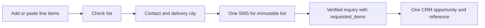

# Fast multi-item purchase inquiry

## Context / PRD

Owner explicitly confirms this is the storefront customer inquiry, not admin product creation (2026-10-28). Goal: minimal effort for many requested products and every catalog category. Current modal only supports black sheet/rebar, one size and kg quantity; one OTP creates one AssistantInquiry/CRM opportunity. Existing challenge holds immutable JSON payload, and existing inquiries remain readable.

## Proposed UX

Retain brand navy/orange and Persian RTL. A wide, compact order-list dialog: visible product-list/contact/OTP progression, short header, editable line cards, category selector using all active catalog categories, free-form specifications with contextual hints, positive quantity plus explicit unit. Add row, duplicate row, remove row; common city/name/mobile entered once. Optional Excel/text import (category name or code TAB specification TAB quantity TAB unit), preview validation before appending, no partial import. Up to 50 items. Keep native dialog focus/escape/close restoration and values when closed/reopened; no localStorage of personal information. A persistent primary action goes to contact, then sends one OTP for the whole list. Back allows corrections with a new request fingerprint. No account required or claimed pricing/stock checks.

## Architecture / API

Add read-only requested_items JSON list to AssistantInquiry (migration), expose to authenticated admin serializer and render full list in inquiries. One verified list creates one inquiry/CRM opportunity/reference. Structured items and readable text preserve every detail; CRM source_payload contains full items (existing need_details remains bounded). Existing code/verify endpoints and OTP quotas unchanged; all sends mocked in development.

Code accepts either legacy product/size_mm/quantity_kg or new items, never both. Items min1/max50: category_code from active category whose ancestors are active; specification nonempty <=200; quantity positive <=100000000 with <=2 decimal places; unit kg/ton/branch/sheet/piece/meter. Snapshot category_name server-side at code time. Unavailable/unknown categories reject before SMS. Existing verified legacy challenge remains supported. Canonical payload handles nested Decimal values and binds all items/contact to the OTP. Only after valid OTP persist requested_items, inquiry and CRM lead atomically. Repeat verification returns the same reference. Reject malformed/bounded input before paid requests.

Options extends existing sizes with categories (code/name/path/kind/default unit), units and max_items. Manual typing of specifications remains possible even with no catalog products. No product catalog writes. Error/malformed provider responses must not appear as successful code delivery/registration. Busy/ref guards prevent duplicate actions.

## Acceptance

Multi-category50-item list verifies once and appears completely in admin and CRM source payload; repeated verify creates no duplicates. Legacy requests still pass. Invalid/51-row lists, hidden categories and changed post-code lists cannot send or register. UI supports add/copy/delete and atomic TSV import, preserves data on back/close/errors, no mobile overflow, keyboard focus and accessible labels. Unit changes are explicit, quantities never silently converted; no cross-unit total. Tests mock SMS, browser APIs and CRM hooks; migration/check/lint/build verified. No real SMS/deploy authorized.
