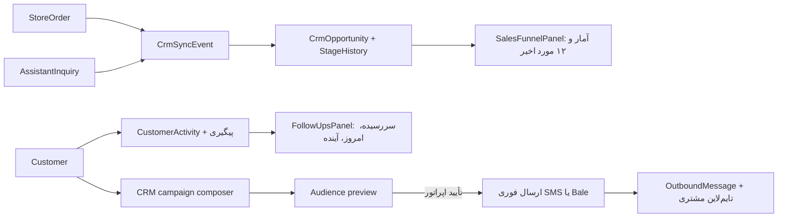
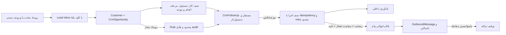

# بازبینی وضعیت فعلی CRM و موتور فروش

تاریخ بررسی: ۷ نوامبر ۲۰۲۶  
محدوده: بک‌اند `kavehmetal back/tg1` و رابط مدیریتی `kavehmetal front`  
وضعیت این بررسی: فقط خواندن کد و اسناد؛ هیچ کد محصول یا داده‌ای تغییر نکرده است.

## جمع‌بندی

CRM فعلی یک دفتر مشتری ساده نیست: مشتری، منبع سرنخ، مرحله ارتباط، دفتر خرید و پرداخت، تایم‌لاین، پیگیری روزانه، فرصت‌های فروش سایت، تاریخچه تغییر مرحله، رخداد همگام‌سازی و ارسال کمپین دارد. دریافت سفارش سایت و استعلام دستیار هم به‌صورت idempotent به فرصت فروش متصل می‌شوند.

کمبود اصلی این است که قطعه‌های موجود هنوز یک «صف کار فروش» یکپارچه نمی‌سازند. پیگیری‌های روزانه به تعامل مشتری متصل‌اند؛ فرصت‌های فروش جدا هستند، اما در رابط فقط ۱۲ مورد اخیر دیده می‌شوند و عملیات واگذاری، اقدام بعدی و تغییر مرحله در صفحه قیف در دسترس نیست. در نتیجه داده‌ها و شاخص‌ها ثبت می‌شوند، اما CRM کارشناس را از سرنخ جدید تا تماس بعدی و بستن هر فرصت هدایت نمی‌کند.

## رفتار فعلی تأییدشده در کد

- `Customer` هویت مشتری و اطلاعات پایه، منبع، مرحله رابطه، دسته‌های محصول موردعلاقه، وضعیت فعال و مانده دفتر دستی را نگه می‌دارد. شماره موبایل یکتا است؛ `upsert_lead` شماره را نرمال می‌کند و اطلاعات پرشده مدیر را بازنویسی نمی‌کند.  
  شواهد: `customers/models.py:7`, `customers/services.py:12`, `customers/services.py:24`.

- `CustomerActivity` تماس، پیام، جلسه، یادداشت، تغییر مرحله و موعد پیگیری را نگه می‌دارد. داشبورد، موارد عقب‌افتاده، امروز و هفت روز آینده را نشان می‌دهد؛ پیگیری مسئول مستقل یا پیوند مستقیم به یک فرصت فروش ندارد.  
  شواهد: `customers/models.py:209`, `customers/views.py:254`, `app/components/admin/FollowUpsPanel.js:32`.

- `CrmOpportunity` چرخه هر معامله را مستقل از مرحله کلی مشتری نگه می‌دارد؛ چند معامله برای یک مشتری پشتیبانی می‌شود. فرصت‌های سفارش و استعلام سایت، تاریخچه تغییر مرحله و رخدادهای شکست‌خورده قابل تلاش مجدد دارند. فیلدهای مسئول، ارزش، اقدام بعدی و موعد در مدل موجودند.  
  شواهد: `customers/models.py:303`, `customers/models.py:439`, `customers/models.py:480`, `customers/opportunities.py`.

- رابط مشتریان جستجو و فیلتر را در مرورگر و روی کل لیست انجام می‌دهد؛ API هم pagination را غیرفعال کرده است. جزئیات مشتری پیام تکی، دفتر دستی، علایق محصول، تایم‌لاین و پیگیری را دارد.  
  شواهد: `customers/views.py:30`, `app/components/admin/CustomerCrmPanel.js:222`, `app/components/admin/CustomerCrmPanel.js:239`, `app/components/admin/CustomerCrmPanel.js:982`.

- صفحه «قیف فروش» شاخص‌های مشتری و فرصت سایت را جدا نشان می‌دهد. فهرست فرصت‌ها فقط ۱۲ رکورد اخیر را نمایش می‌دهد. کلاینت API تابع تغییر مرحله را دارد، اما در UI فعلی استفاده‌ای از آن پیدا نشد.  
  شواهد: `app/components/admin/SalesFunnelPanel.js:86`, `app/components/admin/SalesFunnelPanel.js:233`, `app/lib/crmApi.js:115`.

- کمپین می‌تواند از مشتریان انتخاب‌شده، گروه، دسته محصول، مرحله یا منبع ساخته شود. پیش‌نمایش تعداد و نمونه را می‌دهد و ارسال نیازمند تأیید است. هر تلاش برای مشتری دارای پرونده در `OutboundMessage` ثبت و به تایم‌لاین وصل می‌شود. ارسال کمپین هم‌زمان و فوری است؛ زمان‌بندی، توالی پیگیری و موتور rule/worker وجود ندارد.  
  شواهد: `messaging/service.py:245`, `messaging/service.py:369`, `messaging/views.py:94`, `messaging/views.py:112`, `app/components/admin/CrmCampaignComposer.js:125`, `app/components/admin/CrmCampaignComposer.js:147`.

- مدل رضایت/عدم‌تماس به‌ازای کانال در CRM پیدا نشد و resolver کمپین مشتری فعال را بدون چنین فیلتری می‌پذیرد. بنابراین ارسال بازاریابی خودکار پیش از افزودن کنترل رضایت و توقف پیام امن نیست. APIهای کمپین نیز مجوز بخش `messaging` می‌خواهند، در حالی‌که دکمه کمپین در صفحه CRM بدون بررسی همان مجوز نمایش داده می‌شود؛ برای کاربر فقط دارای مجوز `crm` می‌تواند به خطای دسترسی ختم شود.  
  شواهد: `customers/models.py:7`, `messaging/service.py:245`, `messaging/views.py:94`, `messaging/views.py:112`, `app/components/admin/CustomerCrmPanel.js:49`.

- برنامه «CRM بومی سایت» قبلاً دو قیف مکمل، دفتر سایت به‌عنوان منبع حقیقت، پیگیری مستقلِ مسئول‌دار، توالی، رضایت کانال، ruleهای محدود و صف پیگیری را تعریف کرده است. کارهای Lead inbox، پیگیری مستقل، برد فرصت‌ها و اتوماسیون هنوز در چک‌لیست OpenSpec باز هستند.  
  شواهد: `openspec/prd/site-native-crm-bale-excel-prd.md:88`, `openspec/changes/add-site-native-crm-workspace/tasks.md`.

## شکاف‌های اولویت‌دار

### P0 — صف فروش روزانه و کار با فرصت

فرصت تازه، بدون مسئول، عقب‌افتاده و منتظر پاسخ باید در یک صف قابل اقدام باشد. کارشناس باید از همان‌جا پرونده مشتری، منبع، کالای درخواستی، ارزش، آخرین تماس، اقدام بعدی و موعد را ببیند؛ مسئول را تعیین کند، تماس/پیام را ثبت کند، موعد را عقب بیندازد و مرحله مجاز را عوض کند. فعلاً این اطلاعات عمدتاً در API یا شاخص‌ها هستند.

### P0 — پیگیری مستقل و قواعد مرحله

موعد روی یک تعامل مشتری ذخیره می‌شود، نه روی کار مستقلِ مربوط به یک Opportunity. با بسته شدن معامله، پاسخ مشتری یا تغییر مرحله، لغو/توقف خودکارِ پیگیری‌ها ممکن نیست. باید task/پیگیری مستقل با مسئول، موعد، وضعیت، نتیجه، کانال، فرصت مرتبط و کلید یکتای رخداد ایجاد شود.

### P0 — پایه ایمن برای اتوماسیون ارتباط

برای پیام خودکار باید رضایت به تفکیک مشتری و کانال، زمان/منبع ثبت آن، منع تماس، توقف دنباله پس از پاسخ یا بستن معامله، سقف ارسال، ثبت تلاش، تلاش مجدد محدود و کلید idempotency وجود داشته باشد. ارسال خودکار ابتدا خاموش و قابل پیش‌نمایش باشد. هیچ پیام واقعی در این بررسی فرستاده نشده است.

### P1 — ثبت همه ورودی‌ها و جلوگیری از گم‌شدن سرنخ

ثبت‌نام، دستیار، سفارش و ورودی‌های دستی باید از یک صف ورودی دیده شوند، بدون اینکه مشتری، سفارش، پرداخت یا Opportunity موازی بسازیم. مدل فعلی رویدادهای سایت و فرصت را پوشش می‌دهد؛ Lead مستقل و صفحه inbox در برنامه موجود هستند اما در پیاده‌سازی فعلی نیستند.

### P1 — استفاده راحت‌تر از قابلیت‌های موجود

جستجو، فیلتر، مالک، موعد و مرحله فرصت باید در سرور صفحه‌بندی شوند. در CRM فعلی، کل مشتریان یکجا می‌آید و فیلتر سمت مرورگر است. همچنین نمایش دکمه کمپین باید با مجوز `messaging` هماهنگ باشد.

### P1 — گزارش فروش قابل اتکا

قیف مشتریان و قیف Opportunity باید جدا بمانند. درآمد سایت از سفارش‌های واقعی و IRR می‌آید؛ دفتر دستی مشتری تومان است. یکسان‌کردن یا جمع‌زدن این دو بدون تبدیل و برچسب روشن، گزارش را گمراه می‌کند. داشبورد بعدی باید تاریخ، منبع، محصول، مسئول و دلیل باخت را فیلتر کند.

## طرح پیشنهادی مرحله‌ای

1. **صف کار فروش (اولین تحویل):** به فرصت‌ها و پیگیری‌های موجود نمای inbox بده؛ وضعیت جدید/بی‌مسئول/عقب‌افتاده را برجسته کن؛ واگذاری، مرحله، اقدام بعدی و موعد را از رابط مدیریت کن؛ از داده و سرویس‌های سفارش فعلی استفاده کن؛ فهرست‌ها را صفحه‌بندی و فیلترپذیر کن. پیام خروجی همچنان دستی و تأییدشده بماند.
2. **موتور task و رویداد:** پیگیری مستقلِ مسئول‌دار و متصل به فرصت را بساز؛ با triggerهای محدود مانند سرنخ جدید، قیمت‌گذاری، پیشنهاد ارسال‌شده و موعد ازدست‌رفته task داخلی بساز؛ idempotency، audit، retry و توقف هنگام پاسخ/بسته‌شدن را اضافه کن.
3. **اتوماسیون پیام:** رضایت و عدم‌تماس کانالی را اضافه کن؛ قالب و توالی را با پیش‌نمایش و خاموش/روشن سراسری مدیریت کن؛ ابتدا فقط مخاطب مجاز و قواعد تأییدشده را وارد صف کن؛ گزارش تلاش و لغو را در پرونده مشتری نگه دار. سیاست ارسال خودکار باید قبل از فعال‌سازی توسط مالک تعیین شود.
4. **گزارش و پاک‌سازی داده:** شاخص‌های جداگانه مشتری/فرصت/سفارش، نرخ برد، زمان پاسخ، خرید مجدد و دلایل باخت را با فیلترها بساز؛ ابزار تشخیص و ادغام تکراری را فقط با تأیید و تاریخچه اضافه کن.

## CURRENT — جریان موجود

## PROPOSED — حلقه فروش هدف

## قواعد طراحی برای ادامه

- `Customer.stage` وضعیت کلی رابطه باقی بماند؛ مرحله هر معامله فقط در `CrmOpportunity.stage` تغییر کند.
- `StoreOrder`، پرداخت، موجودی، حمل و استعلام سایت همان منبع حقیقت فعلی بمانند؛ CRM داده تراکنشی دوم نسازد.
- «ساخت task و یادآوری داخلی» از «ارسال پیام بیرونی» جدا بماند.
- اتوماسیون فقط از trigger/actionهای whitelisted استفاده کند؛ کد دلخواه اجرا نشود.
- تا زمانی که تیم فروش و قاعده تقسیم کار مشخص نیست، صفِ بی‌مسئول و تخصیص دستی پشتیبانی شود؛ round-robin پیش‌فرض نشود.
- تا زمانی که رضایت کانال و قواعد ارسال روشن نیست، پیام بازاریابی خودکار خاموش بماند.

## پوشش و محدودیت بررسی

- کد API، مدل‌ها، ورودی سرنخ، sync فرصت‌ها، پنل مشتری، پنل قیف، پیگیری‌ها و کمپین بررسی شد.
- تست‌های موجود خوانده شدند؛ اجرا نشدند. تست‌های بک‌اند CRM در `customers/tests.py` وجود دارند؛ تست‌های فرانت بیشتر ناوبری را پوشش می‌دهند و برای رفتار خود پنل CRM، در جستجوی مسیر `tests`، موردی پیدا نشد.
- هیچ migration، ارسال پیام، build، تغییر داده، deploy یا commit انجام نشده است.
- رابط frontend در شاخه `dev-ariakhayer` از قبل دو تغییر محلی در اسناد داشت؛ دست‌نخورده ماندند: `docs/engineering/HANDOFF.md` و `docs/engineering/PURCHASE_INQUIRY_CURRENT_STATE.fa.md`.

