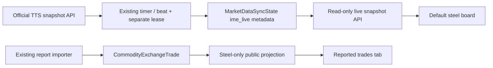

# Steel-chain board + reported trades — 2026-11-02
## Authorization and current context
User: «من نمی دونم هرکاری میدونی بکن که من نمای خوبی در سایتم داشته باشم ... فقط محصولات زنجیره فولاد بیاد کافی هست». Explicit delegated design/implementation, narrowing previous industrial scope. No live deployment or provider-message permission. Existing dev-ariakhayer and scoped push/PrepareOnly authorization preserved. Previous completed workflow industrial-exchange-20261101.
Verified: site reads GetAmareMoamelatList final-report API, not TTS. Read-only Chrome network and urllib GET on official TTS found https://dataapi.ime.co.ir/api/spotmarketdata/GetMarketsInfo and /GetTradesWithId/1. MarketId1 is صنعتی و معدنی. Payload is list of instruments with InstrumentId/MarketId/InstrumentName/InstrumentSymbol/Producer/Supplier/Unit/QtySell/TotalBuyQty/CurrentSellPrice/TradeStatusDesc/IsDeleted. No trading-session date in these responses. Existing snapshot state MarketDataSyncState.metadata JSON and DB lease available. No new entity/migration needed. No complete dataset guarantee.
## PRD / business rules
Default page is periodic official board snapshot for steel chain; second tab final recorded trade history. Only sponge, ore/pellet/concentrate, steel billets/slabs, sheet/coils, rebar, beams/sections/tubes, scrap/steel/castiron, ferroalloys. Cement, copper/aluminium, petro/agri/paper and unknown industrial goods excluded. Keep existing raw history intact; filter all public reported summary/groups/date/producer/list/history projections consistently using shared steel-group predicate. Industrial classifier remains for existing history/import compatibility; steel classifier denies explicit nonsteel even if another word matches.
Board seller price is not final成交/weighted price. Snapshot rows never enter CommodityExchangeTrade or channel report as final trades. Preserve original currency and quantity unit; zero != missing. No mixedunit totals. IsDeleted omitted; Activate=false is not sufficient to discard (observed matched rows havefalse). Invalid shape/identities/nonfinite/negative quantity/prices reject entire snapshot; duplicate IDs reject; empty valid response clears snapshot. MarketId must1 and positively identified steel only. Bounded response size/timeout, fixed officialHTTPS URLs, redirects rejected; no user-suppliedURL/secrets. Failure preserves prior snapshot, markserror/stale; last successful receive time never presented as sessiondate. Show sessiondateunavailable explicitly and source link; not every-minute realtime feed claim.
## Architecture
New products/steel_scope.py shared scope, products/ime_live.py GET validation/parsing/snapshot save; read-only API /api/commodity-exchange/live/ onlyreads DB, neverproviderfetch. Background refresh key ime_live shares admin ime_auto_refresh toggle, separate1minute interval and expiringlease; same existing systemd sync_external_markets command plus Celerybeat60s; force CLI for ownerafterinstall. Failed command marks schedulererror while other markets continue. Public response source/rows/count/fetched_at/has_snapshot/stale/error/session_date=null. No rawprovidererrors exposed.

No new class/ERD required; existing state/trade entities. UI common compact navy header, two prominent tabs «تابلوی عرضه فولاد» / «نتایج معاملات». Steel board labelled search/group, quick sponge/sheet/billet/rebarchips, clearfilter, rows14px, units/source/receivedtime explicit; skeleton/error/stale/neverfetched/empty states. Desktop table, mobile readablecards; keyboard48pxtargets, no outeroverflow. Report tab keeps tablefirst/optionalmap/old-dayrecovery, removes nonsteel labels/options/chips. No duplicate header. Existing URL remains canonical.
## Acceptance / review focus
All public projections exclude cement/copper even with search/history/date=all. Steel inputs include sponge/ore/castiron/tubes. APIneverupstream, backgroundtoggle/interval/lease/error retention, validempty clears, malformed/wrongmarket/duplicates/nonfinite rejects, originalunits/zero preserved. No responseDate manufactured. Mocked browser defaultboard/secondtab/steelonlyfilters/search/mobile/zerovsmissing/stale and separatefinalprices; existing trade race tests stillpass. Review Focus: provider has no sessiondate; snapshot staleness/failure/empty handling, concurrent lease ownership and manualmode; scope leakage through symbols/groups/search; label seller vs finalprice and unit correctness; tab/filter/request races; initialization withoutsnapshot. One inline executing-plans coordinator, TDD; one final fresh read-only review, one fixpass.
